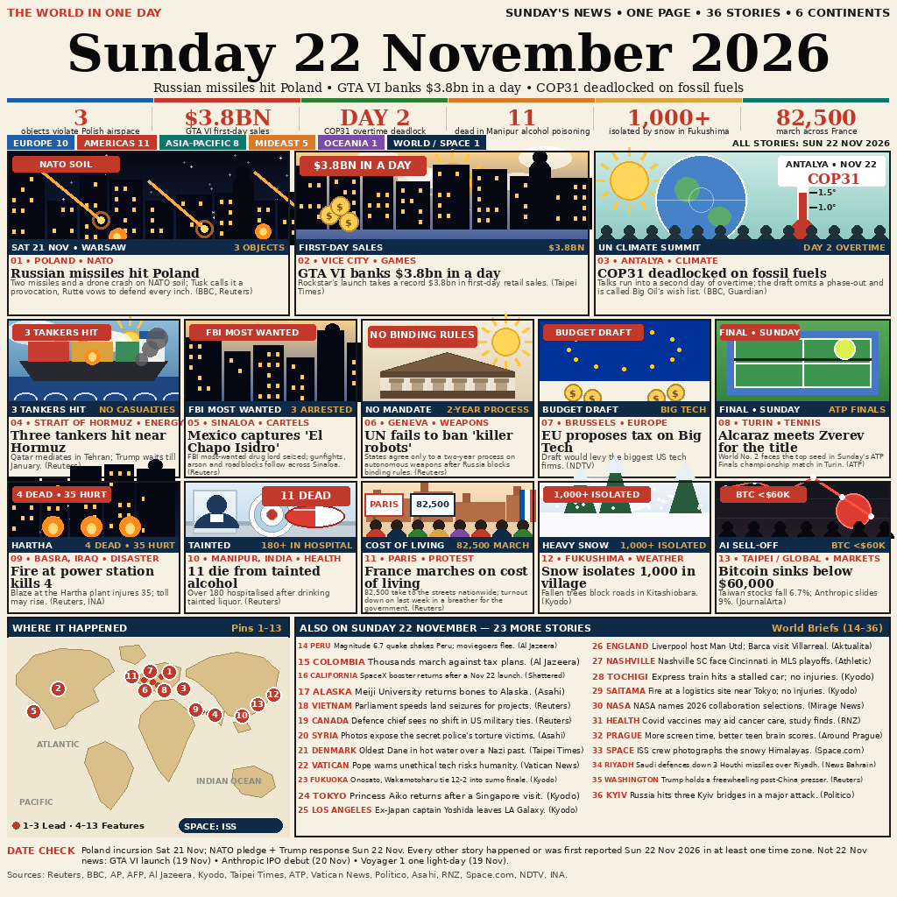

# Sunday 22 November 2026 — The World in One Day

[](https://make.fun/bounty/news-image-20261122)
[](https://make.fun/bounty/news-image-20261122)
[](https://make.fun/bounty/news-image-20261122)

One image that sums up Sunday 22 November 2026's world news: **36 stories,
6 continents, one page** — a serif masthead, a red top-3 banner, ten
illustrated feature panels, a light world map with numbered pins, a
23-item ALSO ON list, and a DATE CHECK footer.



## The top 3

1. **Russian missiles hit Poland** — two missiles and a drone crash on NATO
   soil; Tusk calls it an intentional provocation, NATO's Rutte vows to
   defend every inch. (BBC, Reuters)
2. **GTA VI banks $3.8bn in a day** — Rockstar's launch takes a record
   $3.8bn in first-day retail sales. (Taipei Times)
3. **COP31 deadlocked on fossil fuels** — talks run into a second day of
   overtime; the draft omits a phase-out and is called Big Oil's wish
   list. (BBC, Guardian)

Plus: three tankers hit near Hormuz, Mexico captures 'El Chapo Isidro',
the UN fails to ban 'killer robots', the EU proposes a Big Tech tax,
Alcaraz vs Zverev in the ATP Finals, the Basra power-station fire,
11 dead from tainted alcohol in Manipur, France's cost-of-living marches,
snow isolating 1,000 in Fukushima, and Bitcoin below $60,000 — with 23
more stories in ALSO ON, every one sourced.

## Date check

The Poland incursion happened Sat 21 Nov; NATO's pledge and Trump's
response broke Sun 22 Nov. Every other story happened or was first
reported Sun 22 Nov 2026 in at least one time zone. Not 22 Nov news:
GTA VI launch (19 Nov), Anthropic IPO debut (20 Nov), Voyager 1 one
light-day (19 Nov).

## How it runs

`main.py` is standard-library only: it copies the pre-built `entry.png`
(1024×1024, 230,459 bytes) to `$MAKEFUN_OUTPUT_DIR/entry.png` and
verifies the output is non-empty and within the 1 MiB cap.

```sh
mkdir -p out && MAKEFUN_OUTPUT_DIR=out python3 main.py
```

## Sources

Reuters, BBC, AP, AFP, Al Jazeera, Kyodo, Taipei Times, ATP, Vatican
News, Politico, Asahi, RNZ, Space.com, NDTV, INA, News Bahrain.

## License

MIT — see [LICENSE](LICENSE).
